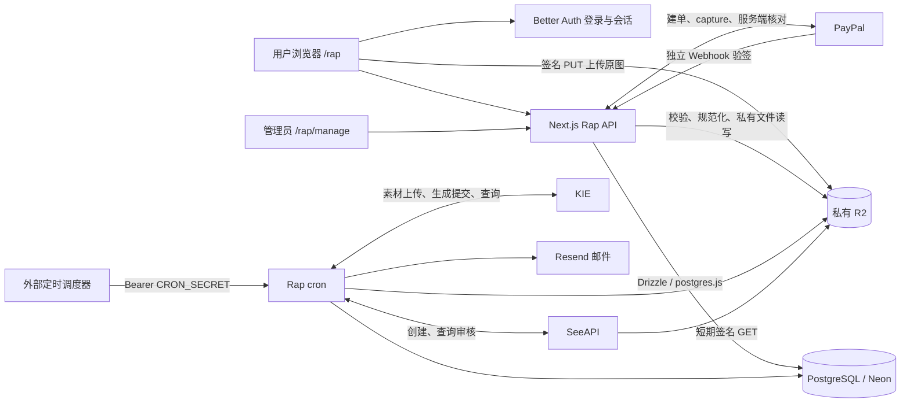
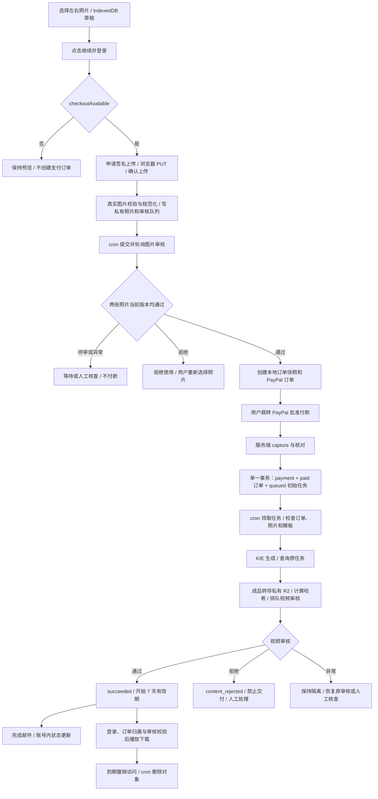
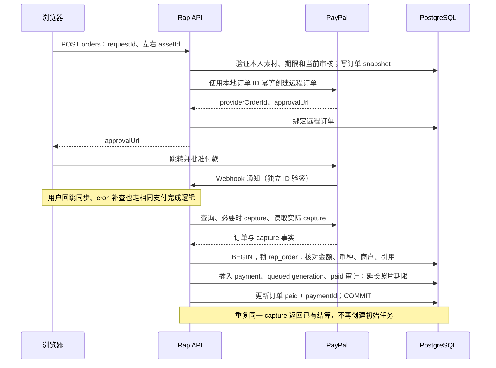
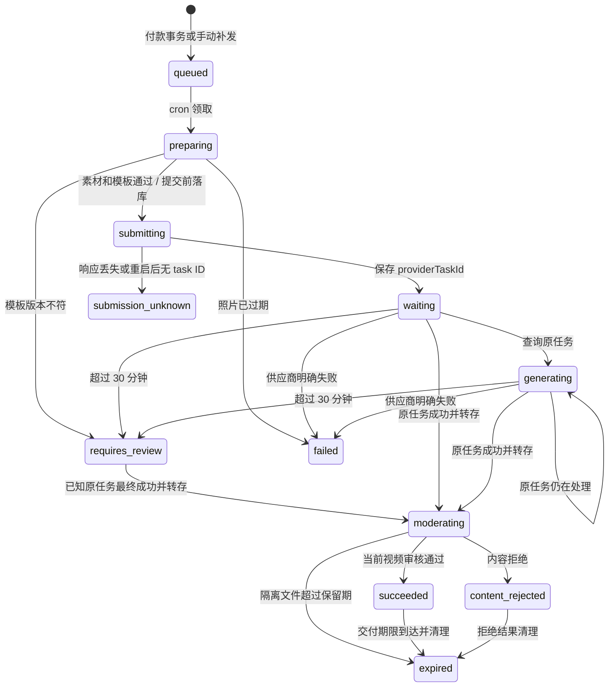

# BOOTH MVP 流程图与执行逻辑

更新：2026-11-06。依据当前仓库 `a0d603d` 的实现，描述代码执行路径，不代表真实外部服务已完成联调。当前商品为 10 秒 / 720p / 9:16、双人照片、固定音轨与模板，单次 $5.99 USD。

关联：[需求 SPEC](./RAPVIDEO-MVP-SPEC.md) · [开发交接](./RAPVIDEO-MVP-IMPLEMENTATION.md) · [数据库切换到 Neon](./operations/rap-neon.md) · [服务配置与部署](./operations/rap-configuration.md) · [R2 运维](./operations/rap-r2.md)。

本文 Mermaid 图可在支持 Mermaid 的 Markdown 预览中查看；下方表格和说明保留相同的执行含义。

## 1. 系统如何连接

- PostgreSQL 保存账号、订单、任务、审核、审计及对象 Key，不保存客户媒体二进制。
- R2 保存临时原图、规范化照片和生成结果；结果由鉴权 API 交付。供应商临时结果 URL 不直接交给用户。
- `rap_generation` 和 `rap_moderation` 是持久化队列；当前没有额外 Redis/BullMQ 服务。
- cron 必须由部署平台或外部调度器实际触发。用户页面刷新只读取状态，不能替代后台处理。
- 本地图形预览、概念海报和参考音轨不是生成成品；现有指令仍要求不调用视频生成 API，所有业务开关保持关闭。

## 2. 从选照片到下载的主流程

技术失败、未知提交与退款另见第 7 节。用户在 PayPal 批准付款不等于数据库已付款；KIE 任务成功也不等于视频可交付。

## 3. 前端与上传执行顺序

入口代码：[落地页](../features/rap/rap-landing.tsx)、[草稿存储](../features/rap/draft.ts)、[上传申请](../app/api/rap/uploads/route.ts)、[上传确认](../app/api/rap/uploads/[id]/complete/route.ts)、[图片保存](../lib/rap/repository.ts)。

| 步骤 | 执行逻辑 | 数据库交互 |
| --- | --- | --- |
| 选照片 | IndexedDB 保存左右文件、请求 ID 和已上传 asset ID；换图清除对应 ID | 此时不写 Rap 表 |
| 登录并继续 | 恢复草稿，读取 `/api/rap/config`；不可购买时保持预览 | Better Auth 使用共享账号/会话表 |
| `POST /api/rap/uploads` | 验证登录、Origin、格式及声明大小，限制每用户每小时 40 次；签发 5 分钟 PUT URL | 事务级 advisory lock 串行化同用户配额检查，插入 `rap_upload`，临时记录有效 24 小时 |
| 浏览器 PUT | 将原文件直传 `temp/` Key | 不写数据库 |
| `POST /api/rap/uploads/:id/complete` | 检查归属和期限，以 2 分钟租约领取确认；HEAD 核对大小/类型，读取字节校验 | 更新 `rap_upload.leaseUntil`；已完成且素材仍有效时返回原 asset ID |
| 规范化照片 | Sharp 解码实际 JPEG/PNG/WebP 单帧图；最小 300×300，比例 0.4–2.5，输入最多 10 MiB / 2500 万像素；旋转、缩至 1536 内、白底、输出 JPEG | 先写新私有对象；同一事务插入 `rap_asset` 和 `rap_moderation`，保存 SHA-256 与当前策略版本 |
| 确认完成 | 把上传记录关联到规范化素材 | 单独更新 `rap_upload.assetId/status`，与上一事务分开 |
| `GET /api/rap/assets/:id` | 按用户归属读取有效素材及当前策略审核状态 | 读 `rap_asset`、`rap_moderation` |

临时上传和审核对象分开：签名 PUT 在有效期内可以重复使用，因此审核只针对新 Key 保存的规范化副本。原临时对象保留到清理期限，不作为审核通过的凭证。

前端一次检查最多 15 次、间隔 2 秒；一分钟 cron 下可能先显示“稍后再点继续”。这只停止本轮页面等待，后台审核仍继续，已上传 ID 会保留。

R2 和 PostgreSQL 不是一个事务。写照片后若插入失败，代码尝试删除对象；进程中断或补偿删除失败仍可能产生孤立对象。照片保存与上传完成标记也分开提交，不能声称整个上传链路严格只执行一次。旧的 `POST /api/rap/assets` 直接上传接口已返回 410。

## 4. 支付、事务与数据库关系

入口代码：[订单 API](../app/api/rap/orders/route.ts)、[支付编排](../lib/rap/payments.ts)、[结算与补发](../lib/rap/repository.ts)、[Rap Webhook](../app/api/rap/paypal/webhook/route.ts)、[表结构](../lib/db/schema.ts)。

### 4.1 创建订单

服务端先检查收费配置、素材归属、有效期、当前哈希对应的审核通过状态。`(userId, requestId)` 唯一约束与输入核对避免重复点击创建不同订单。订单 snapshot 固定价格、规格、提示词、模板和音轨哈希，不从前端价格或回跳参数认定付款。

建本地订单、调用 PayPal、绑定远程 ID 是可恢复的多个步骤，不在同一个数据库事务中。远程创建使用订单 ID 作为幂等依据；已有订单重试需要核对素材和请求一致性。

### 4.2 原子结算

`settleRapPayment()` 在一个事务里锁订单，核验 capture，写入以下记录：

1. 共享 `payment`：ID 为 `paypal:<captureId>`，`creditsGranted=0`。
2. `rap_generation`：状态 `queued`，初始请求 ID 为 `initial:<orderId>`。
3. 两张 `rap_asset`：期限延长到当前时间后 7 天。
4. `rap_audit`：确定性 ID `paid:<orderId>`。
5. `rap_order`：`status=paid` 并关联 paymentId。

其中任一数据库写入失败会回滚本次事务。事务里不调用 PayPal。已经实际捕获的付款即使之后素材审核状态变化，也需保留真实账务事实，再由生成/审核门槛阻止不合规交付。Rap 不修改 `user.credits` 或通用 `credit_ledger`。

### 4.3 核心数据关系

| 表 | 保存内容及关系 | 重要约束/用途 |
| --- | --- | --- |
| `user` / `session` / `account` | 复用账号与登录会话 | 所有客户记录按 userId 校验归属 |
| `rap_upload` | 临时 Key、声明大小/类型、租约、完成后 assetId | storageKey 唯一；到期删除临时对象和记录 |
| `rap_asset` | 用户照片 Key、尺寸、哈希、expiresAt | 订单/任务分别引用左右 assetId |
| `rap_order` | 商品 snapshot、价格、远程订单、paymentId、retryCredits | `(userId, requestId)` 唯一；providerOrderId 唯一 |
| `payment` | 真实 capture 对应的已支付记录 | paymentId 命名空间避免与其他支付混淆；Rap 不发积分 |
| `payment_event` | Webhook 接收、处理及错误记录 | Rap 事件使用 `rap:paypal:<eventId>`；失败留存供恢复 |
| `rap_generation` | 一笔订单的初始任务及后续补发任务、providerTaskId、结果与期限 | `(userId, requestId)` 唯一；providerTaskId 唯一；一个订单可以有多个历史任务 |
| `rap_moderation` | 照片或视频实体、哈希、策略、请求体、审核 task ID、状态与租约 | 对应实体 + 哈希 + 策略版本唯一；idempotencyKey 和 providerTaskId 唯一 |
| `rap_audit` | 付款、失败返还、补发、成品、下载及人工操作 | 关键业务使用确定性 ID 防重复记账 |
| `rap_feedback` | 用户订单反馈、人工处理状态、邮件状态 | `(userId, orderId)` 唯一 |
| `rap_metric` | 匿名漏斗事件 | `(sessionId, event)` 唯一；30 天后清理 |

审核记录由代码写入 assetId 或 generationId；不要把这一约定误认为数据库已有“二选一” CHECK 约束。媒体二进制在 R2，备份数据库不会同时备份文件。

## 5. cron、审核和生成 Worker

入口：[cron 路由](../app/api/cron/rap-video/route.ts)、[生成 Worker](../lib/rap/worker.ts)、[审核 Worker](../lib/rap/moderation.ts)、[SeeAPI 客户端](../lib/rap/seeapi.ts)、[审核判定](../lib/rap/moderation-policy.ts)。

### 5.1 一次 cron 的顺序

`GET /api/cron/rap-video` 校验 `Authorization: Bearer <CRON_SECRET>` 后顺序执行：

| 顺序 | 操作 | 当前批次/时间限制 |
| --- | --- | --- |
| 1 | 清理过期媒体、临时上传和漏斗记录 | 各清理类型有自己的批次 |
| 2 | 为仍有效的旧照片/旧成品补审核队列 | 最多 5 张无哈希旧照片、2 个无 moderatedAt 旧成品 |
| 3 | 推进照片/视频审核 | 最多领取 2 条 |
| 4 | 推进视频生成 | 最多领取 1 条 |
| 5 | 补查未结算 PayPal 订单 | 本次耗时小于 120 秒才执行，最多 1 单 |
| 6 | 完成/客服邮件 | 本次耗时小于 230 秒才开始；内部再按批次处理 |

路由声明 `maxDuration=300`，不是无限运行 Worker。时间预算只控制是否开始后续阶段，不保证整轮绝不超时；未捕获错误也可能中断后续阶段。部署平台必须支持实际时长与调度频率。

### 5.2 为什么不会靠一个长事务等待供应商

生成和审核队列使用短事务 `FOR UPDATE SKIP LOCKED` 领取到期、无有效租约的记录，写租约后提交。生成租约为 6 分钟，审核租约为 90 秒；网络请求在领取事务外进行，再校验租约/状态并保存结果。

`nextRunAt` 控制下次可处理时间，`leaseUntil` 避免并发领取同一条记录。租约不是外部供应商的全局事务：代码还依靠提交前状态、供应商幂等键和已知 task ID 恢复。涉及同一订单和任务的关键事务遵守订单锁 → 生成任务锁；视频审核落库再锁审核记录。

### 5.3 审核执行逻辑

1. 读取 `rap_moderation`，Worker 入口检查审核开关和 SeeAPI Key；首次提交还需要可签名的私有存储，否则无法推进审核。
2. 已有 providerTaskId 就查询原审核任务；没有则为私有对象签发 1 小时 GET URL，将完整请求体和 `submitting` 先保存，再用同一 idempotencyKey 提交。
3. 获取 task ID 后保存为 `processing`；正常待处理约 30 秒后再查询，实际受 cron 周期影响。
4. 供应商 `succeeded` 后解析报告。图片风险命中拒绝；视频必须有完整且符合当前严格策略的采样报告。空报告、格式不符、不完整采样转 `error`，不放行。
5. 终态事务再次检查实体、哈希、策略和可用性。照片只更新审核记录；视频通过时同时写 `succeeded`、`moderatedAt`、`finishedAt`、7 天交付期限和成品审计。视频拒绝写 `content_rejected` 及审计。

暂时性服务错误使用退避重试；明确错误或达到重试边界进入 `error`。审核与媒体哈希、策略版本绑定，换文件不能沿用旧判定。审核策略升级需要专门安排新版本排队，现有旧媒体补队列不会覆盖所有已经有哈希的素材。

管理员仅能恢复 `error` 审核：有 task ID 时继续查询原任务；未知提交且原签名已失效时报 `MODERATION_SUBMISSION_UNKNOWN`，不能换请求体、沿用同一键盲目再付费提交。`rejected` 没有人工一键放行路径。

### 5.4 视频生成状态图

图中是主要路径；订单不再 paid 也会阻断任务，进入核查。`requires_review` 需要结合 error 和 providerTaskId 理解：已知 task ID 的慢任务仍会继续查询原任务；未知 task ID 或模板不匹配不能自动创建新任务。`submission_unknown` 不进入自动生成领取范围。

生成前读取已付款订单、有效照片和当前审核，再验证订单 snapshot 对应模板、提示词及音轨哈希。准备阶段可重传照片/音轨；调用付费 createTask 前先以租约和状态条件写入 `submitting`。提交结果不确定时保留未知态，避免重复购买生成。

生成成功后只下载允许主机的 HTTPS 地址，禁止跳转，限制超时与文件大小；当前转存检查 MP4 容器、最多 100 MiB、时长大于 0 且不超过 30 秒，并计算 SHA-256。**这一检查没有逐项证明成品恰好 10 秒、720p、9:16 或口型/人物质量合格**；供应商请求与上线质量验收仍需分别验证。

先保存私有对象，再在订单锁 → 任务锁的事务中检查租约和 paid 状态，写结果 Key/哈希、`persistedAt`、`moderating` 并排视频审核。转存失败只恢复原供应商任务，不重新生成；未能保留的新对象尝试删除。视频审核异常会保持隔离，不自动增加补发次数。

## 6. 邮件、播放、下载和到期清理

入口：[媒体 API](../app/api/rap/generations/[id]/media/route.ts)、[Worker 邮件与清理](../lib/rap/worker.ts)、[私有存储](../lib/rap/storage.ts)。

- 完成邮件只选择 `succeeded`、未发信、未过期的任务；再检查当前审核和 paid 订单。`emailAttemptedAt` 抑制 15 分钟内重复尝试，成功后写 `emailSentAt`。发送与数据库标记分开，极端情况下会重复发信。
- 播放/下载通过账号会话确认任务归属，再检查订单 paid、结果 Key、成功状态、有效期与当前策略审核；响应使用私有、禁止缓存策略。不能只根据前端显示 `succeeded` 决定授权。
- `download:<taskId>` 审计只记录首次下载请求，不证明文件已完整传输、保存或分享。
- 照片初始有效期 24 小时；付款或补发时延长至 7 天。任务结束后，若没有共享照片的活跃任务，清理会将期限缩短至结束后 24 小时。已有 7 天到期仍可能先到，不能承诺无限保留慢任务照片。
- 成品从审核通过起保留 7 天；拒绝成品结束 24 小时后可清理；未通过审核的隔离文件从转存起最长保留 7 天。实际物理删除依赖下一轮成功 cron，访问校验不等待删除完成。
- 临时原图和 `rap_upload` 记录在到期后清理；R2 `temp/` 生命周期是额外兜底。不要给整个 `rap/` 配一天删除。
- 删除对象失败保留可重试记录；订单、付款与业务审计不随媒体一并删除。数据库备份/供应商副本的保留另行管理，不能把应用删除等同于所有副本已删除。

## 7. 失败、补发、争议与人工恢复

| 情况 | 当前处理 | 相关数据库写入 |
| --- | --- | --- |
| 技术失败且订单 paid | `failRapGeneration()` 锁订单再锁任务；标 failed；每失败任务只返还一次 Rap 生成机会 | 确定性 `failure:<taskId>` 审计成功插入后，`rap_order.retryCredits + 1`；不改通用积分 |
| 用户手动使用补发 | 可换照片，但必须重新满足当前审核；拒绝存在活跃任务的订单 | 订单锁内检查归属、requestId、次数、素材；插入新任务，retryCredits - 1，延长照片期限并写补发审计，同事务提交 |
| 生成提交结果未知 | 不自动 createTask | 保留 `submission_unknown`；管理员去 KIE 核查原请求，取得真实证据后恢复 |
| 视频/图片被拒绝 | 不付款、生成或交付对应不合规内容 | 审核 rejected；视频 content_rejected；不作为技术失败自动补偿 |
| 审核报告异常 | 不放行；恢复原审核或人工核查 | 审核 error；保留必要请求信息，视频继续隔离 |
| PayPal 退款/撤销 | 核对真实付款后冻结订单，等待人工处理 | `rap_order.requires_review`、retryCredits 清零；`payment_event.requires_review` |
| 人工记录退款 | 先在 PayPal 操作；管理员填真实退款 ID，服务端核验全额与 capture 关联 | 核验通过才记录 refunded 和审计；此入口不自动执行退款，不支持自动部分退款 |
| Webhook 或回跳漏处理 | verified webhook、用户 sync 和 cron 都尝试相同完成支付路径 | 事件失败状态保留；cron 只补查近 24 小时、已有远程 ID、未付款的 created 订单，每轮 1 单 |

补发使用同一订单 snapshot，不会顺便升级模板。原模板与当前模板不符时仍需人工核查。未能关联的争议、超过自动补查窗口的订单和失败事件需要运营逐条处理；当前没有一个无限补齐所有历史事件的自动重放服务。

## 8. 阅读代码与排查顺序

1. 看 `lib/rap/config.ts` 与 `/api/rap/config`：先确认业务开关与依赖门槛。
2. 查 `rap_upload` → `rap_asset` → 当前版本 `rap_moderation`：判断上传是否确认、审核是否可用。
3. 查 `rap_order` → `payment` / `payment_event`：区分创建订单、用户批准和真实付款结算。
4. 查 `rap_generation.status/error/providerTaskId/nextRunAt/leaseUntil`：区分未领取、等待、未知提交、失败和人工核查。
5. 有结果 Key 时再查视频审核、moderatedAt 与 resultExpiresAt；转存完成不代表可下载。
6. 最后查通知状态、反馈与审计；不要通过手工把 status 改为 succeeded 绕过审核/支付约束。

数据库连接入口为 [lib/db/index.ts](../lib/db/index.ts)，全局表定义为 [lib/db/schema.ts](../lib/db/schema.ts)，迁移配置为 [drizzle.config.ts](../drizzle.config.ts)。只需更换数据库时按 [Neon 手册](./operations/rap-neon.md) 操作，不需要改每个 Rap API。
