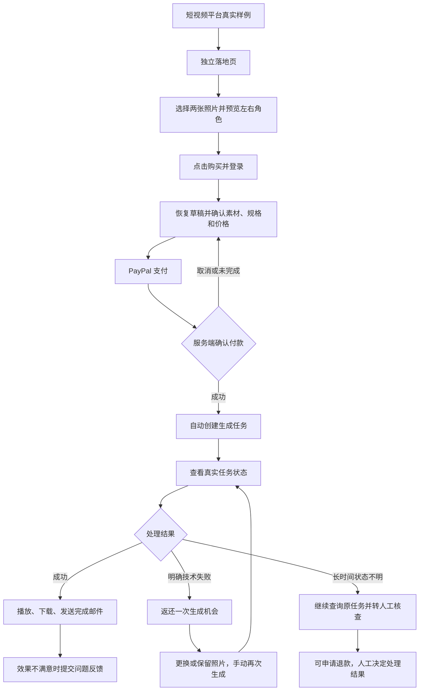

# 双人 Rap 视频 MVP SPEC

版本：1.1

状态：用户已确认，作为开发需求基线

确认日期：2026-10-27

需求已确认；用户于 2026-10-27 授权进入开发，并明确暂不调用视频生成 API。

## 1. 文档定位

本文记录产品讨论后已确认的 MVP 范围，不是完整技术设计，也不表示外部服务、音乐授权、生成质量或成本已经验证。

参考文档：

- [Seedance Mini 接入说明](./NEXTJS-SEEDANCE-MINI-SPEC.md)：供应商接入与已有实测基线。
- [RapVideo 对标行为说明](./RAPVIDEO-LANDING-BEHAVIOR-SPEC.md)：对标产品行为参考。

产品范围以本文为准。参考文档中的其他模型、多模板、原创歌曲、免费预览等功能，不自动进入本 MVP。实现时需要核实供应商当前契约；发现与已确认产品需求冲突时，应提出调整，不得静默扩大范围或降低承诺。

## 2. 产品定义与问题陈述

一句话：面向英语娱乐分享用户，将自己和朋友的两张照片，配合一段固定原创 Rap，生成可下载的 8 秒双人表演视频。

用户希望制作包含自己和朋友的有趣视频，但不愿自己拍摄、演唱或学习剪辑。本产品首先验证：用户看到真实生成效果后，是否愿意为自己的版本付费，并下载结果？

目标用户是英语市场的普通娱乐分享用户，不以专业音乐制作、品牌广告交付或长期创作工作流为首版目标。首批用户来自短视频平台上的真实样例，首轮集中一个平台，具体平台待定。

## 3. 已确认范围

| 项目 | 要求 |
| --- | --- |
| 产品入口 | 新增独立 Rap 落地页，现有模板页面保留 |
| 用户界面 | 英语，手机访问优先 |
| 输入 | 两张单人照片，明确左右顺序 |
| 人物分工 | 左侧主唱、右侧配合，沿用接入文档最小基线 |
| 模板 | 一个固定双人表演模板 |
| 音乐 | 一段制作或购买的原创 Rap，授权范围明确 |
| 视频 | 固定 8 秒、9:16 竖屏、720p |
| 收费 | 按次购买，一次购买对应一个视频 |
| 支付 | 仅 PayPal 单次支付 |
| 登录 | 先选照片，点击购买时登录，登录后恢复草稿 |
| 生成 | 服务端确认付款成功后自动生成 |
| 通知 | 页面状态、账号内记录、完成邮件 |
| 结果 | 在线播放、下载 |
| 技术失败 | 一次性返还生成机会，可换照片后手动使用 |
| 效果问题 | 关联订单反馈，通过邮件人工处理 |

具体售价、音乐素材、模板内容和异常处理时限仍待落实。

## 4. 核心流程

### 4.1 落地页

必须包含产品用途、真实效果样例、两张照片选择器、左右角色说明、固定规格、最终价格、“支付并生成”操作、简短步骤、FAQ、失败及效果误差说明、下载期限、隐私说明、登录和“我的视频”入口、客服入口。

样例必须反映实际使用的模型、模板和规格。不得以经过额外修脸、换音轨等处理的样例暗示普通订单能直接达到相同效果。

### 4.2 照片与登录

- 两个位置分别选择一张单人照片，支持缩略图、替换和移除。
- 明确第一个人物在左侧主唱，第二个人物在右侧配合。
- 预览仅表示素材和人物顺序，不是免费生成视频。
- 缺失、损坏或不符合要求的素材必须在付款前提示。
- JPEG、PNG、WebP 为格式基线；大小和尺寸限制在实现前明确并展示。
- 登录往返后恢复照片和顺序；恢复失败或素材失效时要求重选，不能用无效素材进入付款。

### 4.3 付款与自动生成

付款前展示照片、人物分工、固定模板和音乐、8 秒/9:16/720p、最终价格、技术失败处理和保存期限。

- 按钮明确表达“支付并生成”。
- 付款前保存有效草稿，订单绑定该版本素材；后续编辑不改变已付款任务。
- 仅凭服务端确认的支付成功启动生成，不能凭返回 URL 或用户批准支付发放权益。
- 关闭返回页不影响已付款订单履约，用户回来后能找到任务。
- 重复点击、通知重发、刷新不能导致重复履约或重复生成。
- 支付取消不生成；支付状态未明确时显示确认中，不诱导重复购买。

### 4.4 等待与结果

| 状态 | 用户体验 |
| --- | --- |
| 支付确认中 | 等待确认，可查看订单 |
| 等待提交或排队 | 已记录任务，无需重复操作 |
| 生成中 | 可以离开页面 |
| 处理异常、核查中 | 状态不明，可反馈或申请退款 |
| 已完成 | 播放、下载、明确到期时间 |
| 明确失败 | 失败说明及已返还的生成机会 |
| 视频过期 | 不可下载，仍能查看订单及联系客服 |

不编造百分比，不承诺未经验证的完成时间。完成后发送邮件；邮件失败不影响任务成功或账号内获取结果。

### 4.5 技术失败、效果反馈和异常等待

明确技术失败且没有可用视频：原任务只返还一次机会；用户可以更换或保留照片，手动开始新任务；新任务关联原订单和补发记录。不得形成无人值守的无限自动重试。

已出片但相似度、口型或表演不满意：结果页提供“反馈问题”，自动关联订单，允许填写描述及补发/退款诉求。申请不等于自动批准，通过邮件人工处理并记录决定。视频到期后，订单仍保留客服入口。

超过待确定的处理阈值：转人工核查并继续查询原任务，提供退款申请入口。等待超时不等于生成失败，不自动返还或重发。已退款或补发后原任务又成功的处理规则须在上线前明确，避免重复补偿。

## 5. 音乐、隐私与保存期限

固定原创音乐的授权必须覆盖商业生成服务、多位付费用户重复使用、用户下载并发布包含音乐的成品。不能只凭“可商用”字样认定覆盖所有用途。最终音频必须参与效果验证。

| 数据 | 规则 |
| --- | --- |
| 已结束任务的照片 | 任务结束后 24 小时内从本系统删除 |
| 生成视频 | 保留 7 天，到期后不可下载 |
| 订单与处理记录 | 视频过期后仍用于订单查询与客服处理 |
| 供应商侧素材 | 另行核实、披露，不把本地删除宣称为所有副本删除 |

草案建议视频保留期从结果可用时间起计算，并在结果页及完成邮件展示明确到期时间。

未付款/取消购买草稿、长期状态不明任务的照片清理期限尚待确定，不能无限保留。不得对外声称这两类清理已落实。

## 6. 技术约束与复用边界

- 在当前 Next.js 项目内新增独立入口，优先复用登录、PayPal、邮件、存储和记录查询能力。
- 现有一次性积分包不等于完整的按次视频购买能力；仍需明确订单、素材快照、生成任务和补发机会之间的关联。
- 产品购买流程不展示通用积分包、订阅及无关 AI 功能。
- 使用 KIE Seedance 2.0 Mini，服务端固定模型和模板，不照搬对标站其他模型的能力。
- 密钥仅存于服务端；用户只能访问自己的素材、订单和结果。
- 任务处理、邮件通知、结果保存与清理不能依赖浏览器持续打开。
- 提交结果不明时不自动再次调用创建任务；保留可追踪状态并核查原任务。
- 付款履约、失败返还、人工补发必须防止重复执行，保持账目与权益一致。
- 真实生成仅由明确授权的测试，或用户购买/使用补发机会触发。

现有文档实测基线为 4 秒、480p、16:9。本产品的 8 秒、720p、9:16 需另行验证，不能沿用前者的成本、耗时或质量承诺。

## 7. 明确不做

- 自带音乐、音频裁剪、AI 写歌、声纹克隆。
- 双人轮流演唱选项、合照拆分、单人模式。
- 多舞台、多模板、Effects 特效目录。
- 自定义提示词、动作参考视频。
- 时长、清晰度和画幅选择器。
- 免费生成预览。
- 订阅、多档积分套餐、多支付渠道。
- 批量生成、多候选结果。
- 视频编辑器、自动发布到社交平台。
- 完整工单中心、多语言推广。
- 重做整个 SaaS 模板网站。

## 8. 开发前质量门槛

使用最终音乐和模板，对 5 组不同人物素材验证：素材获适当授权；每组只生成一次；统一 8 秒、720p、9:16；记录所有结果、实际费用、等待时间、输出信息和人工评价；至少 4 组合格再推进该效果的收费版本。

单组要求：

- 两个人均可辨认，无明显脸部融合、人物缺失或身份交换。
- 双人构图不明显裁掉关键面部。
- 左侧主唱口型无明显持续错位，右侧符合配合者定位。
- 音画正常播放，时长与约定相符，允许正常编码差异。
- 手机观看效果达到真实样例展示水平。

5 组验证是首轮门槛，不是长期成功率证明。不通过则先调整模板或产品承诺，再推进网站开发和推广。真实测试须先落实素材与预算，不因确认本文自动执行付费调用。

## 9. 成功标准

首轮观察两周：至少 10 位非亲友用户付费；至少 90% 的付费任务成功交付可播放、可下载的视频；至少 5 位付费用户实际下载。

统计要求：

- 内部测试、亲友支持单独标记。
- 技术交付与满意度分别记录，投诉与补偿不能忽略。
- 首次任务和补发任务分别记录，不能以补发成功掩盖首次失败。
- 记录访问、选素材、登录、支付、生成、下载漏斗。
- 记录生成、支付手续费、存储及补偿成本。
- 下载不等于社交分享。
- 流量不足时延长观察，不直接判定无需求。

## 10. 功能验收清单

| 范围 | 验收条件 |
| --- | --- |
| 入口 | 独立地址可访问，手机完成核心流程 |
| 宣传 | 样例、音乐、规格与实际结果一致 |
| 素材 | 两张照片可预览、替换、移除，角色明确 |
| 校验 | 无效素材不能进入付款 |
| 登录 | 登录往返后草稿与人物顺序一致 |
| 支付 | 金额和购买内容明确，以服务端确认结果为准 |
| 履约 | 付款后关闭页面仍能创建并找回任务 |
| 重复保护 | 通知重发、刷新、重复点击不重复履约 |
| 恢复 | 刷新或重新登录能查看真实状态 |
| 成功 | 可播放、可下载，显示到期时间 |
| 邮件 | 链接指向对应结果，发送失败不丢结果 |
| 失败 | 只返还一次机会，可换照片手动使用 |
| 超时 | 状态不明不自动重发，可人工核查 |
| 反馈 | 关联订单，记录补发或退款决定与处理结果 |
| 权限 | 不可读取其他用户素材、视频和订单 |
| 清理 | 按期限清理，视频到期仍可查订单 |
| 联调 | 完成 PayPal 沙箱验证，上线前受控真实支付验证 |

## 11. 上线前待落实事项

1. 产品名称与独立入口地址。
2. 固定音乐、授权证明、最终表演模板。
3. 5 组验证结果及实际成本。
4. 单次售价、每单成本与验证预算。
5. 异常处理阈值、客服响应时间、退款申请与晚到结果处理规则。
6. 未付款草稿、长期异常任务的素材清理期限。
7. 供应商素材留存规则。
8. 首轮推广平台、真实样例、客服邮箱。

## 12. 执行顺序

1. 落实音乐、人物测试素材和验证预算。
2. 执行 5 组效果验证，记录质量、成本和耗时。
3. 根据证据落实售价、处理阈值等待定项；重大产品调整重新确认。
4. 实现独立落地页及购买、生成、结果、补偿最小闭环。
5. 按验收清单验证后，开始首轮推广与两周观察。

不得以待定事项为理由擅自增加订阅、多模型或其他非 MVP 功能，也不得把文档确认描述成开发、联调或上线已完成。

## 13. 开发启动补充决定（2026-10-27）

用户提供 `inputs/left.png`、`inputs/right.png`，授权准备其他素材与音乐，按对标文档定价并进入开发。随后明确：先不要调用 API 生成视频。此后指令覆盖第 8、12 节中“先完成真实验证再开发”的执行顺序；质量验证仍是收费上线门槛。

- 独立入口 `/rap`，工作品牌 BOOTH，可后续替换。
- 对标文档 Mini 720p/8 秒为 6 积分；最小包 $9.99/10 积分，折算 $5.994，取单次 $5.99 USD。不是把最小包价格直接当单次价格；真实毛利尚未验证。
- 先提供原创程序化节拍与英语合成参考人声的 8 秒音乐草案，提供试听及素材来源；不是已确认商业授权的最终人声母带。
- 静态概念海报必须标注非真实生成视频。不得将它制作成假模型成果或冒充质量验证。
- 未付款上传草稿保留 24 小时；长期异常输入最多保留 7 天；结果从可用时间起保留 7 天。
- 30 分钟未完成先标记核查，继续查询原任务；此为可调整的初始运营阈值，不是完成时限承诺。
- 生成与收费开关默认关闭；开发、自动化测试使用模拟响应和隔离数据库，不执行真实视频调用、支付或退款。
